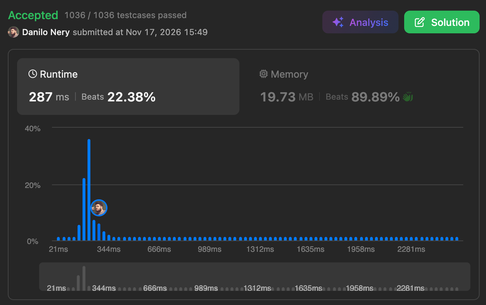

# [Longest Substring Without Repeating Characters](https://leetcode.com/problems/longest-substring-without-repeating-characters/)

### [Solution](main.py)

## Notes

- In Python, all of the following operations are `O(1)` in the general case:
  - Setting a dict key
  - Evicting (`del`) a dict key
  - Checking if a key exists in a dict (hashing is constant but up to `O(n)` on worst-case collision count)
- However, doing `word = {ch: 0 for ch in s}` before the sliding window actually gives a smaller memory footprint as opposed to adding keys, checking and evicting them, presumably because what is being measured is total allocation, and Python provides no guarantees that re-adding a previously evicted key occupies the same memory (allocation buffer, arena, whatever the GC does).

## Timing

- Best version completed in ~9m
