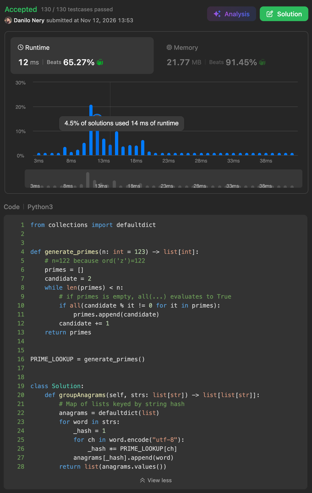

# [Group Anagrams](https://leetcode.com/problems/group-anagrams)

### [Solution](main.py)



## Why does this work?

1. The fundamental theorem of arithmetic: **every integer greater than 1 is either a prime itself or a product of prime factors.**
2. Multiplication over complex numbers (and therefore over reals, integers and naturals) is commutative.

The solution then becomes obvious if we choose to encode characters as numbers, e.g. via Python char `ord()` or string `.encode()`, which produces ASCII decimals for lowercase english words. Use these values as indexes into a precomputed prime lookup array, which only needs 123 valid positions (because `ord('z') = 122`) so it's very cheap to generate even with a trivial algorithm.

All of this allows us to hash strings to a single integer **invariant to character position.** The following demonstrates how "eat" and "tea" can be identified as anagrams via this strategy:

```python
def generate_primes(n=123):
    primes = []
    candidate = 2
    while len(primes) < n:
        if all(candidate % it != 0 for it in primes):
            primes.append(candidate)
        candidate += 1
    return primes

PL = generate_primes()

hash_of_eat = PL[ord('e')] * PL[ord('a')] * PL[ord('t')]
hash_of_tea = PL[ord('t')] * PL[ord('e')] * PL[ord('a')]

assert hash_of_eat == hash_of_tea  # evaluates to True
```

## Data mining Leetcode

The stated constraints for problem 49 are:

- `1 <= strs.length <= 104`
- `0 <= strs[i].length <= 100`
- `strs[i]` consists of lowercase English letters.

One would think that the hidden test cases would exercise these constraints strictly, right? Not exactly.

One of my submissions had a misguided assumption that forcing the `_hash` to be contained in 64 bits with a hex mask would yield faster runtimes, by preventing Python bigint machinery to kick in. The submission contained the following differences:

```python
#...
PRIME_LOOKUP = generate_primes()
MASK_64 = 0xFFFFFFFFFFFFFFFF

class Solution:
    def groupAnagrams(self, strs: list[str]) -> list[list[str]]:
        #...
            #...
                _hash = (_hash * PRIME_LOOKUP[ch]) & MASK_64
#...
```

For starters, I have no idea whether this prevents Python bigint logic from doing it's thing, and even if it does, I _know_ it does not provide runtime improvements in Leetcode (this particular submission was actually slower).

Well, here's the thing: the submission passed, **but it shouldn't.** Not if the constraints are being exercised strictly, that is. The `_hash` grows quite fast and easily blows past 64 bits in storage requirement, even for medium sized words.

Consider the best case to be the single-char word `a` and the worst case to be 100-char word containing only `z`s (if you don't assume the words have to be valid). The following demonstrates how quickly the `_hash` blows past 64 bits:

```python
import math

def generate_primes(n=123):
    primes = []
    candidate = 2
    while len(primes) < n:
        if all(candidate % it != 0 for it in primes):
            primes.append(candidate)
        candidate += 1
    return primes

PL = generate_primes()

def bits_required(word: str) -> int:
    _hash = 1
    for ch in word:
        _hash *= PL[ord(ch)]
    return math.ceil(math.log2(_hash))

def grow(ch='a', max=64):
    for length in range(1, 101):
        word = ch * length
        bits = bits_required(word)
        print(f"\"{word}\" (length {length}) requires {bits} bits")
        if bits > max:
            break

grow('a')
grow('z')
```

This is the output:

```
"a" (length 1) requires 10 bits
"aa" (length 2) requires 19 bits
"aaa" (length 3) requires 28 bits
"aaaa" (length 4) requires 37 bits
"aaaaa" (length 5) requires 46 bits
"aaaaaa" (length 6) requires 55 bits
"aaaaaaa" (length 7) requires 64 bits
"aaaaaaaa" (length 8) requires 73 bits
"z" (length 1) requires 10 bits
"zz" (length 2) requires 19 bits
"zzz" (length 3) requires 29 bits
"zzzz" (length 4) requires 38 bits
"zzzzz" (length 5) requires 48 bits
"zzzzzz" (length 6) requires 57 bits
"zzzzzzz" (length 7) requires 66 bits
```

Because the submission was accepted, the conclusion is that **none of the test case inputs contain strings longer than 7 chars in length.** In all fairness, it's safe to assume (although not stated) that the inputs contain only valid words, and anagrams become more scarce the longer the words get.

## Timing

- Best version completed in ~15m
